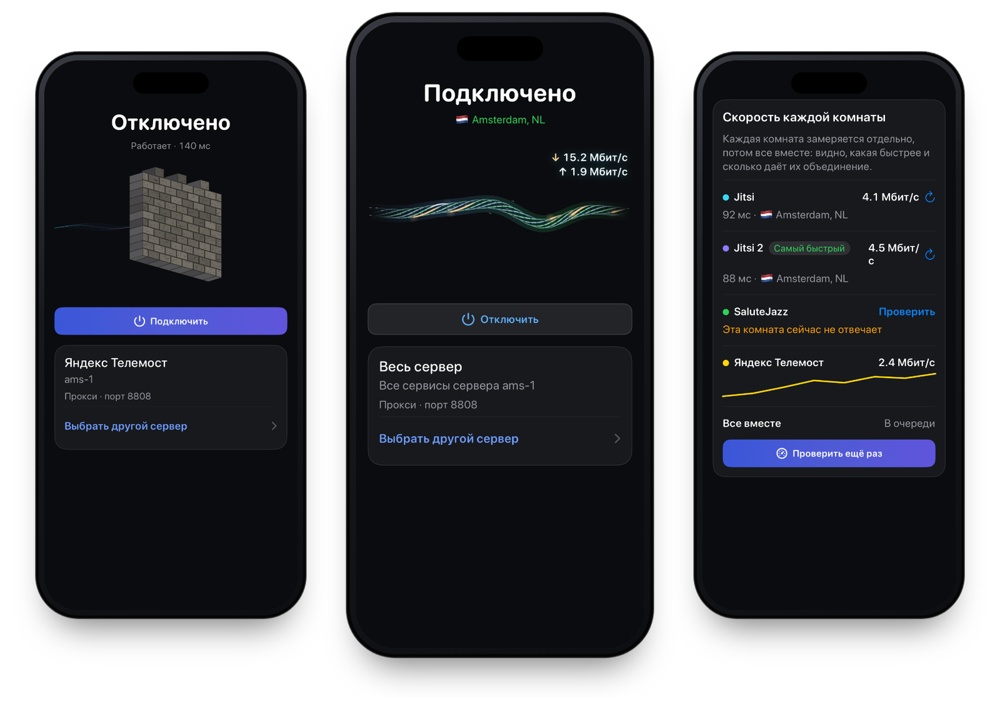

<p align="center">
  
</p>

<h1 align="center">olcOS for iPhone and iPad</h1>

<p align="center">
  A VPN and SOCKS5 proxy through your own server, carried inside a video call. iOS and iPadOS 17+, SwiftUI.
</p>

<p align="center">
  <a href="https://github.com/olcOS/olcos/releases/latest"></a>
  
  <a href="LICENSE"></a>
</p>

<p align="center">
  <a href="https://olcos.github.io/en/">Website</a> ·
  <a href="https://github.com/olcOS/olcos/releases/latest">Download</a> ·
  <a href="https://github.com/olcOS/olcos">olcOS</a> ·
  <a href="https://github.com/olcOS/olcos-android">Android</a> ·
  <a href="README.md">Русский</a>
</p>

<p align="center">
  
</p>

olcOS takes the internet of your iPhone or iPad through your own server. The traffic travels inside an ordinary
video call (Yandex Telemost, Jitsi, SaluteJazz, VK Calls, MTS Link) or straight to the server over Xray
(VLESS + REALITY). Add a connection from a link, a QR code, a file or a subscription, or let the app install your own
server over SSH.

The app is available in English, Russian and French; switch the language in Settings.

## Features

- Connect with a link, QR code, file, subscription or a ready-made list. When a server stops answering, the app moves
  to another one that works.
- Install your own server over SSH. One server can run several protocols, and the Whole server connection bonds
  their rooms into one channel.
- Live speed for each protocol on the home screen, and a connection check that measures every room on its own and
  all of them together.
- Russian sites open directly, outside the tunnel: banks, government services and others. You can add your own list.
- A VPN for the whole device, or a SOCKS5 proxy for apps that support one: Telegram, Potatso, Shadowrocket.
- Widgets for the Home Screen, Lock Screen and Control Center, and a Live Activity with the speed in the Dynamic
  Island.
- Auto-connect on mobile data and on chosen Wi-Fi networks.
- Invites for other devices, including invites that allow server management. olcOS for Android accepts them too.

## Install

1. Download the `.ipa` file from the [latest release](https://github.com/olcOS/olcos/releases/latest) or
   [build it yourself](docs/build.md).
2. Install it with Sideloadly, AltStore or SideStore.
3. Open olcOS and add a connection.

With a free Apple ID, iOS does not give the app VPN mode, so only the SOCKS5 proxy works. The device-wide VPN,
widgets and the Live Activity work when the app is signed with a paid Apple Developer account.

More on the free Apple ID:

- the signature lasts 7 days, then the app has to be re-signed (AltStore and SideStore do it while they run);
- if AltStore asks what to do with the extensions (the VPN tunnel and the widgets), remove them; they don't work with
  a free Apple ID anyway;
- after you tap Connect, a proxy card appears on the home screen with a Use in Telegram button, or the
  `127.0.0.1` address and port for other apps. In Potatso and Shadowrocket, add the olcOS server to the exceptions;
  the link is on the same card.

## Connect

1. Tap + in the top right corner and paste a link, scan a QR code, open a file, add a link or subscription, or pick a
   ready-made list.
2. If you have a VPS, choose + → My own server (VPS): the app connects over SSH and installs everything. The other way
   is one command on the server itself (Debian, Ubuntu, Fedora or CentOS, as root):

   ```bash
   curl -fsSL https://raw.githubusercontent.com/olcOS/olcos/main/install.sh | sudo bash
   ```

   At the end it prints a QR code. Scan it in olcOS on iPhone or Android and that device becomes the server's owner.
   Rooms, protocols, invites and core updates are then handled in the app, without SSH.
3. Tap Connect.
4. To give access to family or friends, open the server card → Share → Invite a device. Each device gets its own
   link.

Connection links contain keys. Don't post them publicly.

## Modes

| | VPN | SOCKS5 proxy |
|---|---|---|
| What goes through the tunnel | the whole device | apps that have the proxy set |
| Needs a paid signature | yes | no |
| Whole server | trial, up to three rooms | all rooms |

More about modes and routing in [docs/setup.md](docs/setup.md).

## Limitations

- The VPN carries TCP over IPv4. Apps that need UDP or IPv6 may not work through it.
- Speed depends on your network and on the call service. A service can close a room or restrict guests.
- This is a beta, and behaviour and compatibility still change.
- Use the app within the law of your country and the terms of the services your traffic goes through.

## When something doesn't work

| Problem | What to do |
|---|---|
| It won't connect | Open the Connection check on the home screen; it shows which protocol answers. For a subscription, tap Find the fastest and connect. |
| It's slow | Measure the protocols in the Connection check and connect to the fastest one, or to Whole server if bonding adds speed. |
| A proxy runs instead of the VPN | The app is signed with a free Apple ID and iOS did not allow the VPN, so olcOS switched to the proxy. Sign it with a paid developer account and choose VPN in Settings. |
| You need help | Settings → View all logs → Export all logs, then [open an issue](https://github.com/olcOS/olcos/issues/new/choose). Remove keys, passwords and full links from the logs first. |

Report vulnerabilities privately, see [SECURITY.md](SECURITY.md). Diagnostic codes are listed in
[docs/diagnostic-messages.md](docs/diagnostic-messages.md).

## Building from source

You need macOS with Xcode 15 or later, XcodeGen, Go and the GitHub CLI.

```bash
gh repo clone olcOS/olcos-ios -- --recurse-submodules
cd olcos-ios
./scripts/build-framework.sh
xcodegen generate --spec project.yml
open olcrtc-ios.xcodeproj
```

This repository also holds the Go core that the Android app uses: `gomobile/` (the tunnel glue, room bonding and the
server agent), `olcos-core/` (the Xray engine) and the `olcrtc-upstream/` submodule.

Documentation:

- [docs/build.md](docs/build.md): building, tests and release files;
- [docs/architecture.md](docs/architecture.md): how the app works;
- [docs/uri.md](docs/uri.md): link and subscription formats;
- [CONTRIBUTING.md](CONTRIBUTING.md): how to propose changes.

## Licenses

olcOS is released under the [MIT](LICENSE) license, Copyright (c) 2026 Hotelk52339. The olcrtc core
([ghostlane-project/olcrtc](https://github.com/ghostlane-project/olcrtc), the continuation of the archived
[openlibrecommunity/olcrtc](https://github.com/openlibrecommunity/olcrtc)) is under [Apache-2.0](olcrtc-upstream/LICENSE)
with a [NOTICE](olcrtc-upstream/NOTICE); the original upstream license is
[WTFPL](olcrtc-upstream/docs/upstream-license-wtfpl.txt). Xray-core is under
[MPL-2.0](https://github.com/XTLS/Xray-core/blob/main/LICENSE).
