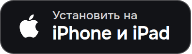
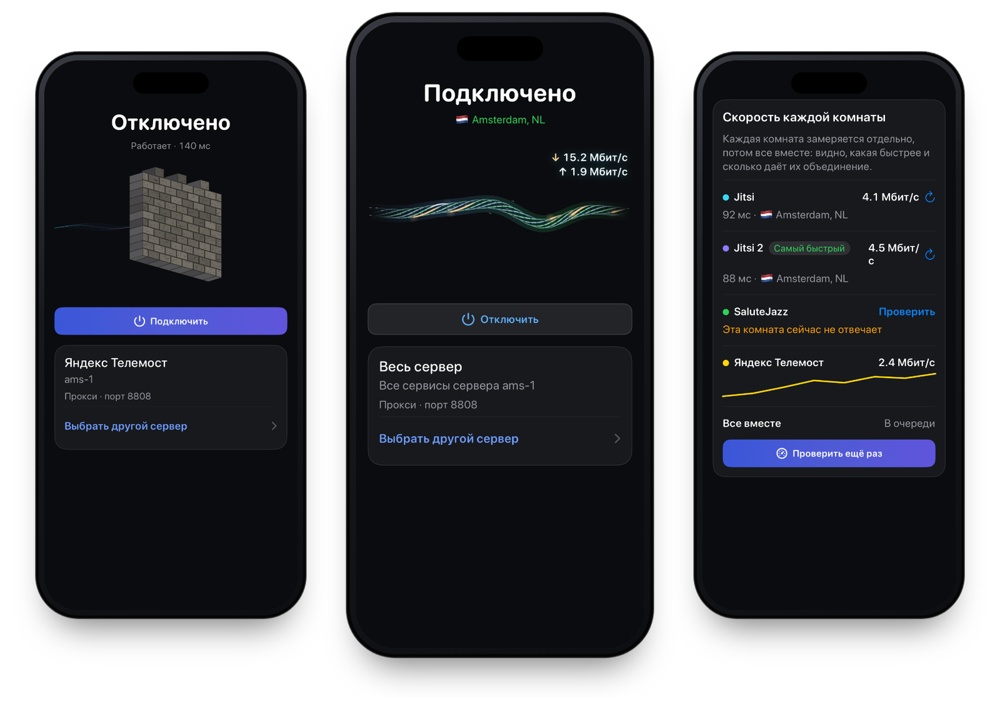

<p align="center">
  
</p>

<h1 align="center">olcOS для iPhone и iPad</h1>

<p align="center">
  Исходный код приложения olcOS для iOS и iPadOS 17+.<br>
  olcOS помогает обойти белые списки мобильного интернета через видеозвонки.
</p>

> [!IMPORTANT]
> **Хотите просто установить приложение?** Здесь лежит исходный код. Готовый файл и пошаговая инструкция для iPhone
> находятся в [главном репозитории olcOS](https://github.com/olcOS/olcos#iphone-и-ipad) и на
> [сайте](https://olcos.github.io/#download).

<p align="center">
  <a href="https://github.com/olcOS/olcos#iphone-и-ipad"></a>&nbsp;
  <a href="https://github.com/olcOS/olcos#android"></a>
</p>

<p align="center">
  <a href="https://olcos.github.io">Сайт</a> ·
  <a href="https://github.com/olcOS/olcos">Инструкция</a> ·
  <a href="https://github.com/olcOS/olcos#если-не-работает">Если не работает</a> ·
  <a href="https://github.com/olcOS/olcos-android">Android</a> ·
  <a href="README.en.md">English</a>
</p>

<p align="center">
  
</p>

## Что это

olcOS ведёт интернет iPhone или iPad через ваш собственный сервер. Трафик идёт внутри обычного видеозвонка (WebRTC)
в одном из сервисов звонков, которые поддерживает приложение. Их список есть в самом приложении и пополняется с
обновлениями. Когда мобильный интернет работает по белому списку, обычный VPN не может достучаться до своего сервера,
а звонок в сервис из белого списка оператор пропускает. Если белых списков нет, к серверу можно подключиться и
напрямую через Xray (VLESS + REALITY): так скорость не ограничена звонком.

Нужен iPhone или iPad с iOS 17 или новее. Файл IPA весит около 55 МБ и ставится через компьютер.

Как работают белые списки, как установить приложение и поставить сервер, рассказано в
[главном репозитории](https://github.com/olcOS/olcos).

Интерфейс на русском, английском и французском, язык меняется в настройках.

## Возможности

- Подключение по ссылке, QR-коду, файлу, подписке или из готовых подборок. Если сервер перестал отвечать, приложение
  само переключится на другой рабочий.
- Установка своего сервера по SSH. На одном сервере можно держать несколько протоколов и подключаться ко всем сразу:
  в режиме «Весь сервер» комнаты склеиваются в один канал.
- Скорость каждого протокола на главном экране и отдельная проверка соединения, где каждая комната замеряется
  отдельно и все вместе.
- По желанию российские сайты, например банки и Госуслуги, можно пустить напрямую, мимо туннеля. Можно добавить
  свой список.
- Режим VPN для всего устройства или SOCKS5-прокси для приложений, которые его поддерживают: Telegram, Potatso,
  Shadowrocket.
- Виджеты для экрана «Домой», экрана блокировки и Пункта управления, Live Activity со скоростью в Dynamic Island.
- Автоподключение на мобильном интернете и в выбранных сетях Wi-Fi.
- Приглашения для других устройств, в том числе с доступом к управлению сервером. Их принимает и olcOS для Android.
- Настройки для тех, кто знает, что меняет: кадры и пакеты видеоканала VP8 (по умолчанию 30 кадров по 64 пакета),
  DNS, порт и логин прокси. У подключений Xray можно поменять сервер, SNI, flow, отпечаток TLS и short ID.

## Режимы

| | VPN | SOCKS5-прокси |
|---|---|---|
| Что идёт через туннель | всё устройство | приложения, в которых указан прокси |
| Нужна платная подпись | да | нет |
| «Весь сервер» | пробно, до трёх комнат | все комнаты |

С бесплатным Apple ID iOS не даёт приложению режим VPN, поэтому работает только прокси. Подробнее о режимах,
маршрутизации и ограничениях VPN — в [docs/setup.md](docs/setup.md).

## Сборка из исходников

Нужны macOS с Xcode 15 или новее, XcodeGen, Go и GitHub CLI.

```bash
gh repo clone olcOS/olcos-ios -- --recurse-submodules
cd olcos-ios
./scripts/build-framework.sh
xcodegen generate --spec project.yml
open olcrtc-ios.xcodeproj
```

Ядро на Go и серверная часть лежат в отдельном репозитории [olcOS/olcos-core](https://github.com/olcOS/olcos-core),
он подключён сюда подмодулем `olcos-core/`. Это же ядро использует приложение для Android: клиент olcrtc, обвязка
туннеля, склейка комнат, агент сервера, движок Xray и скрипты установки сервера.

Документация:

- [docs/build.md](docs/build.md) — сборка, тесты и релизные файлы;
- [docs/architecture.md](docs/architecture.md) — как устроено приложение;
- [docs/setup.md](docs/setup.md) — режимы, установка сервера и диагностика;
- [docs/uri.md](docs/uri.md) — форматы ссылок и подписок;
- [docs/diagnostic-messages.md](docs/diagnostic-messages.md) — коды диагностических сообщений;
- [CONTRIBUTING.md](CONTRIBUTING.md) — как предложить изменения.

## Ошибки и безопасность

Ошибки и вопросы пишите в [Issues главного репозитория](https://github.com/olcOS/olcos/issues/new/choose). Приложите
логи (Настройки → «Смотреть все логи» → «Выгрузить все логи») и уберите из них ключи, пароли и полные ссылки. Об
уязвимостях сообщайте приватно, см. [SECURITY.md](SECURITY.md).

Пользуйтесь приложением в рамках закона своей страны и правил сервисов, через которые идёт трафик.

## Лицензии

olcOS распространяется под лицензией [MIT](LICENSE), Copyright (c) 2026 Hotelk52339. Ядро olcrtc
([ghostlane-project/olcrtc](https://github.com/ghostlane-project/olcrtc), продолжение заархивированного
[openlibrecommunity/olcrtc](https://github.com/openlibrecommunity/olcrtc)) распространяется под
[Apache-2.0](https://github.com/olcOS/olcos-core/blob/main/olcrtc/LICENSE) с [NOTICE](https://github.com/olcOS/olcos-core/blob/main/olcrtc/NOTICE), исходная лицензия апстрима —
[WTFPL](https://github.com/olcOS/olcos-core/blob/main/olcrtc/docs/upstream-license-wtfpl.txt). Движок Xray-core — [MPL-2.0](https://github.com/XTLS/Xray-core/blob/main/LICENSE).
